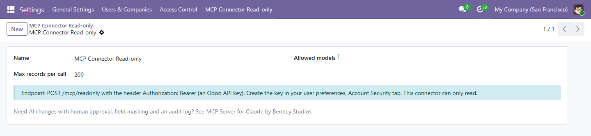

# MCP Connector Read-only for Odoo

A small Odoo module that adds a **read-only [Model Context Protocol](https://modelcontextprotocol.io) (MCP) server** to your own Odoo. Claude, ChatGPT-compatible clients, Cursor or any other MCP client can then list models, read their fields, search, read and count records in your database.

There is no create, write or delete tool. The AI signs in with an Odoo API key and works as that user, so normal Odoo access rights and record rules apply.

Works on Odoo 15.0, 16.0, 17.0, 18.0, 19.0 and 20.0 (one branch per version, module folder at the root). Licence: LGPL-3.



## What the AI can do: 5 tools

| Tool | What it does |
|---|---|
| `odoo_list_models` | Lists the models the connected user can read |
| `odoo_describe_model` | Fields of a model, with types and labels |
| `odoo_search_read` | Search with a domain, choose fields, order and limit |
| `odoo_read` | Read records by id |
| `odoo_count` | Count records matching a domain |

Example questions: "How many open quotations do we have?", "Show me the last 10 invoices for Gemini Furniture".

## Install

1. Pick the branch that matches your Odoo version (for example `19.0`).
2. Copy the `bs_mcp_readonly` folder into your addons path (or add this repo to `addons_path`).
3. Restart Odoo, turn on developer mode, then Apps > Update Apps List.
4. Search for "MCP Connector Read-only" and click Install.

```bash
git clone --branch 19.0 --single-branch https://github.com/DuncanBentley/odoo-mcp-readonly.git
```

## Connect your AI client

First create an API key: in Odoo open your user preferences, Account Security tab, New API Key. Use a dedicated user for the AI if you can, and give that user only the access it should have.

The server URL is `https://your-odoo.example.com/mcp/readonly`.

**Claude Code**

```bash
claude mcp add --transport http odoo https://your-odoo.example.com/mcp/readonly \
  --header "Authorization: Bearer <odoo api key>"
```

**Claude Desktop** (`claude_desktop_config.json`, using the `mcp-remote` bridge)

```json
{
  "mcpServers": {
    "odoo": {
      "command": "npx",
      "args": [
        "mcp-remote",
        "https://your-odoo.example.com/mcp/readonly",
        "--header",
        "Authorization: Bearer ${ODOO_API_KEY}"
      ],
      "env": { "ODOO_API_KEY": "<odoo api key>" }
    }
  }
}
```

**Cursor** (`~/.cursor/mcp.json` or `.cursor/mcp.json`)

```json
{
  "mcpServers": {
    "odoo": {
      "url": "https://your-odoo.example.com/mcp/readonly",
      "headers": { "Authorization": "Bearer <odoo api key>" }
    }
  }
}
```

**Any other client that speaks MCP over HTTP**: POST JSON-RPC to the URL above with the header `Authorization: Bearer <odoo api key>`.

## Security notes

- **Read-only.** No tool creates, changes or deletes data.
- **API key.** The key belongs to one Odoo user. Revoke it in the user's preferences at any time. Use HTTPS so the key is not sent in clear text.
- **Access rights apply.** The AI sees what that user could open in Odoo: groups, record rules and multi-company rules all count.
- **Allowed models.** Under Settings > MCP Connector Read-only (administrators only) you can list the only models the AI may read. Fields that point to models outside the list come back as ids only, and searches that reach into a model that is not allowed are refused. Leave the list empty to allow every model the user can read.
- **Record limit.** Max records per call is 200 by default (1 to 5000).
- Whatever the AI reads is sent to the AI provider you chose. Decide which models and users are fine for that.

## Tests

The module ships automated tests (`tests/test_mcp.py`) that run on all six Odoo versions: `odoo-bin -d test --test-tags /bs_mcp_readonly -i bs_mcp_readonly --stop-after-init`.

## Need approved writes, masking and an audit log?

This connector only reads. If you want AI to also create or change records, but only after a person approves each change, with field masking, rate limits and a full audit log, see our paid **MCP Server for Claude** on the Odoo Apps store:
https://apps.odoo.com/apps/modules/19.0/mcp_gatekeeper

## About

Built by Bentley Studios. Issues and pull requests are welcome.
